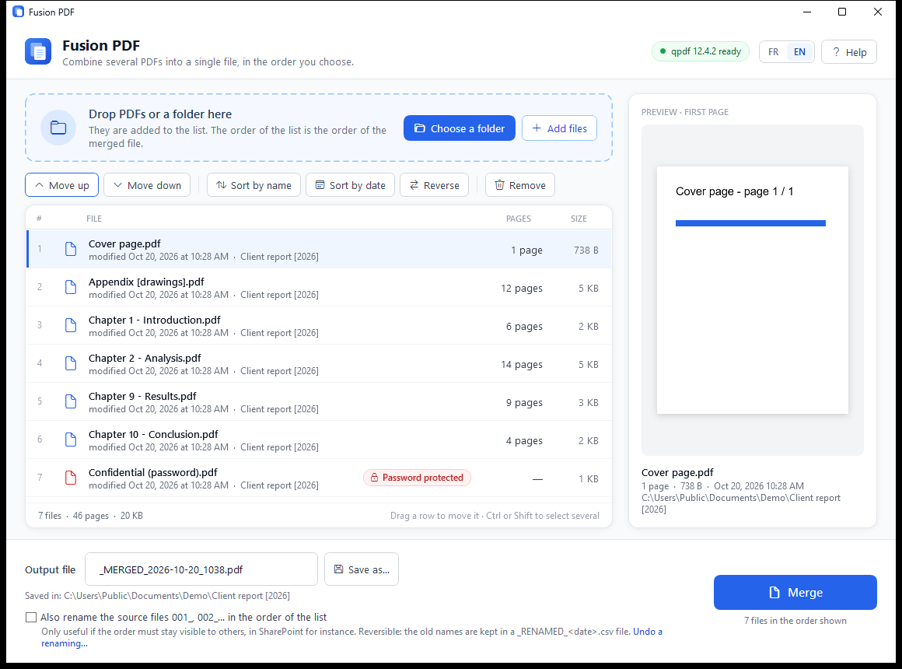

<p align="center">
  
</p>

<h1 align="center">Fusion PDF</h1>

<p align="center">
  <b>Combine several PDFs into a single file, in the order you choose.</b><br>
  A simple Windows desktop app, in English and French, built on top of <a href="https://github.com/qpdf/qpdf">qpdf</a>.
</p>

<p align="center">
  <b>English</b> · <a href="README.fr.md">Français</a>
</p>

> **Unofficial tool.** Fusion PDF is an independent project. It is not affiliated
> with, endorsed by, or maintained by the qpdf project. It only calls the `qpdf`
> command-line program, which must be installed separately.



## Why

Merging PDFs should not require a script, a console, or uploading confidential
documents to a website. Fusion PDF gives non-technical users a clean window:
drop the files, check the order, click **Merge**. Pages are copied as-is by qpdf,
so there is **no quality loss**, and 150 files merge in seconds.

## Features

- **Drag and drop** PDFs or whole folders, or right-click a folder in File Explorer:
  *Merge the PDFs in this folder*.
- **Reorder** by dragging rows, or with *Move up / Move down*, *Sort by name*
  (natural sort: `page9` before `page10`), *Sort by date*, *Reverse*.
- **First-page preview** of the selected file (Windows' built-in PDF engine).
- **Page count and size** of each file, and of the whole list.
- **OneDrive "online-only" files** are detected and downloaded automatically before merging.
- **Clear error messages**, naming the faulty file: password-protected, damaged,
  locked by another program, empty folder, qpdf missing.
- **Optional renaming** of the sources `001_`, `002_`… in list order,
  **reversible** from a CSV log (*Undo a renaming…*).
- **Responsive while merging**: the merge runs in the background with a progress bar.
- **English and French**, following Windows, with an **FR | EN** switch in the window.
- **Built-in help** (F1), shown automatically on first launch.
- **No installer framework, no runtime to deploy**: one 200 KB `.exe` on .NET Framework 4.8,
  which ships with Windows 10 and 11.

## Requirements

| | |
|---|---|
| Windows | 10 or 11, x64 |
| .NET | Framework 4.8 (included in Windows 10 1903+ and Windows 11) |
| qpdf | installed separately: `winget install QPDF.QPDF` |

## Quick start

1. Install qpdf: `winget install QPDF.QPDF`
2. Download `FusionPDF.exe` from the [latest release](../../releases/latest) and run it.
   To get the Start menu shortcut and the right-click command for all users, run
   `package\install.ps1` as administrator instead (see the [deployment guide](docs/en/deployment.md)).
3. Drop your PDFs, check the order, click **Merge**.

## Documentation

| | English | Français |
|---|---|---|
| User guide | [user-guide.md](docs/en/user-guide.md) | [guide-utilisateur.md](docs/fr/guide-utilisateur.md) |
| Deployment (Intune, scripts) | [deployment.md](docs/en/deployment.md) | [deploiement.md](docs/fr/deploiement.md) |
| Building from source | [building.md](docs/en/building.md) | [construire.md](docs/fr/construire.md) |
| Troubleshooting | [troubleshooting.md](docs/en/troubleshooting.md) | [depannage.md](docs/fr/depannage.md) |

## Repository layout

```
src/         C# 5 / WPF sources, XAML, English translations (textes.en.txt)
resources/   icon and tiles
package/     install.ps1, detection.ps1, uninstall.ps1 (SYSTEM, Intune-ready)
intune/      qpdf package, .intunewin builder, Graph publishing script (plan / -Apply)
tools/       Build-FusionPDF.ps1, New-Icone.ps1, Get-TextesATraduire.ps1
docs/        user, deployment and build guides, in English and French
```

Code comments are in French, the language the tool was first written in.

## Licence

[Apache License 2.0](LICENSE). qpdf is a separate program, under its own licence
(also Apache 2.0); it is not included in this repository. See [NOTICE](NOTICE).
