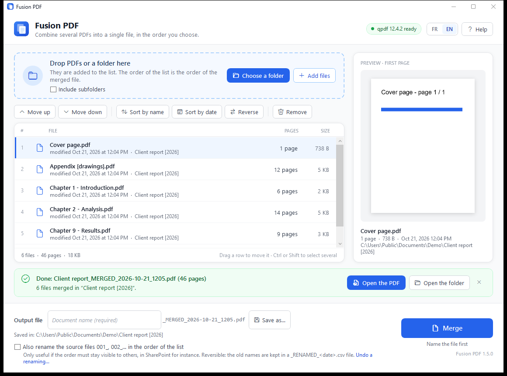
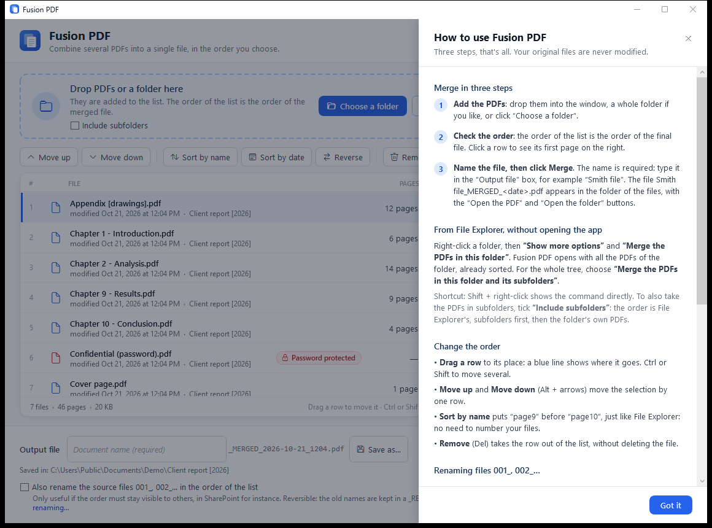

# User guide

[Français](../fr/guide-utilisateur.md) · [Back to README](../../README.md)

Fusion PDF combines several PDF files into one, in the order you choose. Your
original files are never modified (unless you ask for them to be renamed).

## Merge in three steps

1. **Add the PDFs.** Drop files or a whole folder into the window, or click
   **Choose a folder** / **Add files**. Only PDFs placed directly in a folder are
   taken, unless **Include subfolders** is ticked: then those of its subfolders are taken
   too, in File Explorer name order: at each level, subfolders first, then the
   folder's own PDFs. The choice is remembered.
2. **Check the order.** The order of the list is the order of the merged file.
   Click a row to see its first page on the right.
3. **Name the file, then click Merge.** The name is required: type it in
   **Output file**, for example `Smith file`. The file
   `Smith file_MERGED_<date>.pdf` is created in the folder of the files. A green banner shows its name and page count, with **Open the PDF** and
   **Open the folder**.

## From File Explorer

Right-click a folder, then **Show more options** › **Merge the PDFs in this
folder** (on Windows 11; **Shift + right-click** shows it directly). It also
works when right-clicking the empty area inside an open folder. Fusion PDF opens
with all the PDFs of the folder, already sorted by name.

For the whole tree, choose **Merge the PDFs in this folder and its subfolders**:
each subfolder first, in name order, then the folder's own PDFs, the same rule applying
inside each subfolder — whatever the state of the *Include subfolders* checkbox,
which is left unchanged for next time.

> The right-click command is added by `package\install.ps1`. If you only
> downloaded `FusionPDF.exe`, use drag and drop instead.

## Changing the order

| | |
|---|---|
| Drag a row | a blue line shows where it will go; Ctrl or Shift to move several rows |
| **Move up** / **Move down** | moves the selection by one row (Alt + ↑ / Alt + ↓) |
| **Sort by name** | natural sort, like File Explorer: `page9` before `page10`, so there is no need to number your files |
| **Sort by date** | oldest first |
| **Reverse** | reverses the whole list |
| **Remove** | takes the row out of the list (Del); the file itself is not deleted |

## The output file

The name is what you type in **Output file**, followed by `_MERGED_<date>.pdf`,
added automatically and shown next to the box. Without a name, **Merge** refuses
and the box turns red. The `_MERGED_<date>` ending marks the file as a merge: it
is never picked up again when the folder is reloaded.

The file goes to the opened folder; **Save as…** chooses another one. A file with
the same name is never overwritten: Fusion PDF adds ` (2)`. After a merge the box
is cleared, so the next document asks for its own name.

## Renaming the sources 001_, 002_…

Only useful when the order must stay visible to others, for instance in a shared
SharePoint folder. Tick **Also rename the source files…**: after a successful
merge, the files are renamed in list order. A prefix already present is removed
first, so running it twice never gives `001_001_`.

The old names are kept in `_RENAMED_<date>.csv`, next to the files. **Undo a
renaming…** reads that file and gives the files their original names back.

## OneDrive "online-only" files

Files that are still in the cloud are labelled **Online only**. Nothing to do:
they are downloaded automatically when you merge. You just need an Internet
connection. Their page count and preview appear once downloaded.

## Language

The interface follows the Windows display language (French or English). The
**FR | EN** buttons, top right, switch it at any time; the choice is remembered
and the current list is kept.

## Help

The **Help** button (or **F1**) opens the built-in guide. It also opens by itself
the first time you launch Fusion PDF.

## Messages

See [troubleshooting](troubleshooting.md).
