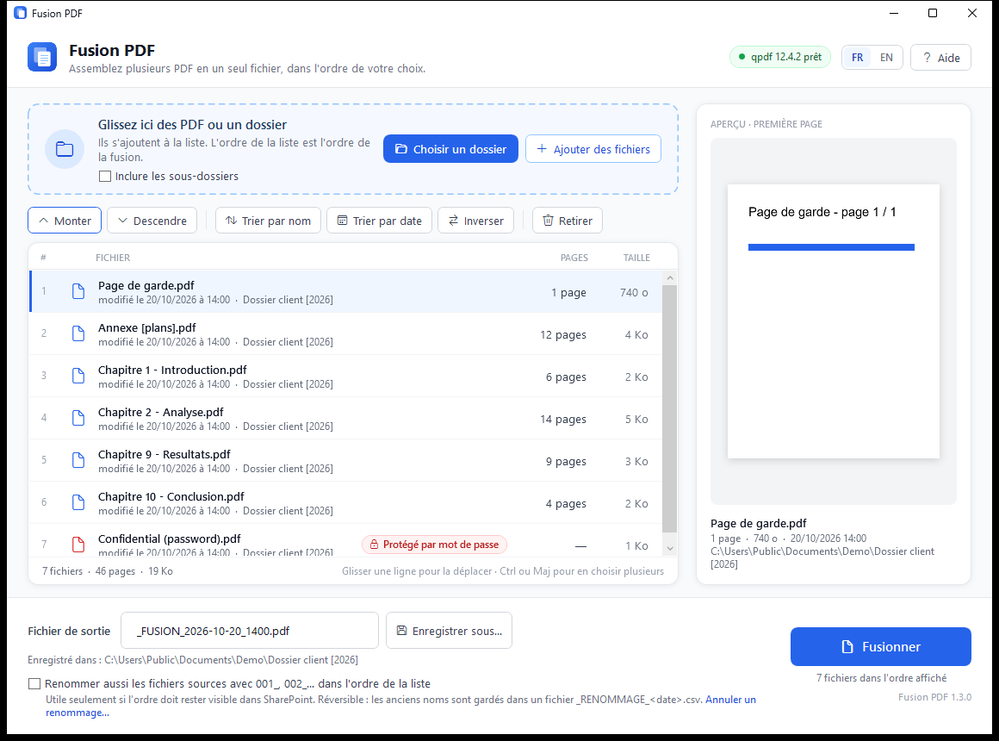
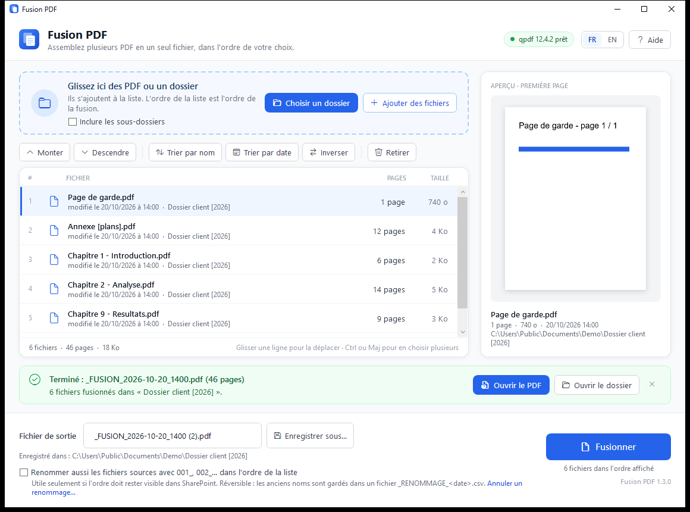
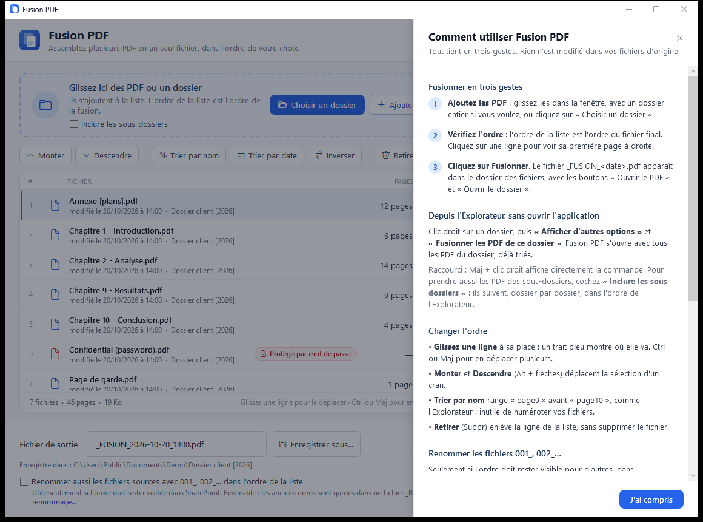

# Guide utilisateur

[English](../en/user-guide.md) · [Retour au README](../../README.fr.md)

Fusion PDF assemble plusieurs fichiers PDF en un seul, dans l'ordre de votre
choix. Vos fichiers d'origine ne sont jamais modifiés (sauf si vous demandez à
les renommer).

## Fusionner en trois gestes

1. **Ajoutez les PDF.** Déposez des fichiers ou un dossier entier dans la
   fenêtre, ou cliquez sur **Choisir un dossier** / **Ajouter des fichiers**.
   Seuls les PDF placés directement dans un dossier sont pris, sauf si **Inclure les
   sous-dossiers** est coché : ceux des sous-dossiers suivent alors, dossier par dossier,
   dans l'ordre de l'Explorateur. Le choix est mémorisé.
2. **Vérifiez l'ordre.** L'ordre de la liste est l'ordre du fichier final.
   Cliquez sur une ligne pour voir sa première page à droite.
3. **Cliquez sur Fusionner.** Le fichier `_FUSION_<date>.pdf` est créé dans le
   dossier des fichiers. Un bandeau vert indique son nom et son nombre de pages,
   avec **Ouvrir le PDF** et **Ouvrir le dossier**.

## Depuis l'Explorateur

Clic droit sur un dossier, puis **Afficher d'autres options** › **Fusionner les
PDF de ce dossier** (sous Windows 11 ; **Maj + clic droit** l'affiche
directement). Cela fonctionne aussi d'un clic droit dans le vide, à l'intérieur
d'un dossier ouvert. Fusion PDF s'ouvre avec tous les PDF du dossier, déjà triés
par nom.

> Le clic droit est ajouté par `package\install.ps1`. Si vous avez seulement
> téléchargé `FusionPDF.exe`, utilisez le glisser-déposer.

## Changer l'ordre

| | |
|---|---|
| Glisser une ligne | un trait bleu montre où elle va ; Ctrl ou Maj pour en déplacer plusieurs |
| **Monter** / **Descendre** | déplace la sélection d'un cran (Alt + ↑ / Alt + ↓) |
| **Trier par nom** | tri naturel, comme l'Explorateur : `page9` avant `page10`, inutile de numéroter vos fichiers |
| **Trier par date** | du plus ancien au plus récent |
| **Inverser** | inverse toute la liste |
| **Retirer** | enlève la ligne de la liste (Suppr) ; le fichier, lui, n'est pas supprimé |

## Le fichier de sortie

Le nom proposé est `_FUSION_<date>.pdf`, dans le dossier du premier fichier.
Modifiez-le dans **Fichier de sortie**, ou choisissez un autre dossier avec
**Enregistrer sous…**. Si un fichier du même nom existe déjà, Fusion PDF demande
avant de le remplacer.

## Renommer les sources 001_, 002_…

Utile seulement si l'ordre doit rester visible pour d'autres, par exemple dans
un dossier SharePoint partagé. Cochez **Renommer aussi les fichiers sources…** :
après une fusion réussie, les fichiers sont renommés dans l'ordre de la liste.
Un préfixe déjà présent est d'abord retiré : relancer ne donne jamais `001_001_`.

Les anciens noms sont gardés dans `_RENOMMAGE_<date>.csv`, à côté des fichiers.
**Annuler un renommage…** lit ce fichier et rend leurs noms d'origine aux fichiers.

## Fichiers OneDrive « en ligne seulement »

Les fichiers restés dans le cloud portent l'étiquette **En ligne seulement**.
Rien à faire : ils sont téléchargés automatiquement au moment de la fusion. Il
faut seulement être connecté à Internet. Leur nombre de pages et leur aperçu
s'affichent une fois téléchargés.

## Langue

L'interface suit la langue d'affichage de Windows (français ou anglais). Les
boutons **FR | EN**, en haut à droite, la changent à tout moment ; le choix est
mémorisé et la liste en cours est gardée.

## Aide

Le bouton **Aide** (ou **F1**) ouvre le mode d'emploi intégré. Il s'ouvre aussi
tout seul au premier lancement de Fusion PDF.

## Messages

Voir le [dépannage](depannage.md).
